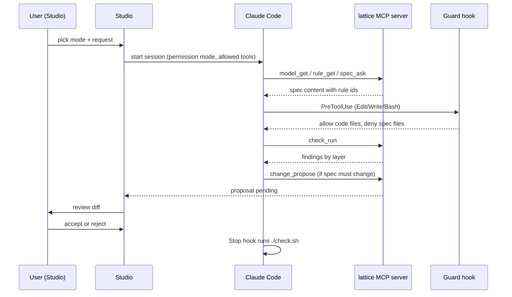

# Lattice and Claude Code integration

Status: v0.1 design note. Code: `lattice-claude-plugin/`, `lattice/mcp/` (M1), `lattice/studio/templates/CLAUDE.md.tmpl`.

## Two directions

1. **Claude Code uses Lattice.** The plugin gives a coding session read-only access to the spec (MCP tools), protects spec files (guard hook), and gates completion on `./check.sh` (Stop hook). Spec changes go through `change_propose` and are accepted by a human in Studio.
2. **Studio uses Claude Code.** Studio modes (ask, explain, change, rebuild) launch Claude Code sessions with a fixed permission profile per mode (table below). Studio owns accept/reject.

## Session flow



## Mode permission table

| Studio mode | Claude permission mode | Allowed tools | Hooks |
|---|---|---|---|
| ask | `dontAsk` (anything not allowlisted is denied) | Read, Grep, Glob + model_get, rule_get, spec_ask, code_links, graph_get, spec_lint (MCP server `--readonly`) | guard |
| explain | `dontAsk` | same as ask, code-reading prompt | guard |
| change | `dontAsk` | ask's tools + `change_propose`, `change_get`, `change_list` (MCP server talks to Studio via `--studio-url`) | guard |
| rebuild (not enabled yet) | acceptEdits, in a git worktree | read tools, check_run, Edit/Write on code paths, Bash for `./check.sh` | guard + Stop gate (`LATTICE_GATE=strict`) |

Every mode also passes `--tools Read,Grep,Glob` (only these built-ins exist), `--disallowedTools Edit,Write,MultiEdit,NotebookEdit,Bash`, `--strict-mcp-config --mcp-config <session mcp.json>`, `--settings <session settings.json>` (the guard hook) and `--setting-sources "" --disable-slash-commands`.

## Verified on Claude Code 2.1.296 (2026-10-10)

Run against the real CLI (subscription login, `apiKeySource: "none"`, no `ANTHROPIC_*` in the child env):

- Every flag of `build_argv` is accepted, including `--permission-mode dontAsk`, the `--` separator before the prompt and `--include-partial-messages` with `--verbose`. The init record lists exactly `Glob, Grep, Read` + `mcp__lattice__*`; the `lattice` server reports `connected` under `--strict-mcp-config`.
- **`--setting-sources ""` is needed.** Without it the owner's user settings load: their plugins (here a SessionStart hook injecting a long skill page, 100+ skills and slash commands) entered every Studio turn and made an Ask turn cost about 8x more ($0.085 vs $0.011). Settings passed with `--settings` (the guard hook) still apply with no sources.
- The guard's default JSON deny (`hookSpecificOutput.permissionDecision: "deny"`) is honoured: the Edit is blocked, the model gets a `tool_result` with `is_error: true` and text `PreToolUse:Edit hook error: <reason>`, and the call is listed in the result's `permission_denials`.
- Stream shape differences from the hand-written fakes (the parser already copes; a redacted real transcript is in `tests/studio/fixtures/`): `system` records with subtypes `hook_started`, `hook_response`, `status`, `thinking_tokens`; a `rate_limit_event` record; `thinking` content blocks; one `assistant` record per content block (same message id); `tool_use` blocks also streamed as `content_block_start` with empty input; `usage.input_tokens` excludes cache tokens (so it is tiny; the cost is in `total_cost_usd`).
- Plugin: Claude Code namespaces a plugin's MCP tools as `mcp__plugin_lattice_lattice__<tool>` (server `plugin:lattice:lattice`), so the commands' `allowed-tools` list that spelling as well as `mcp__lattice__<tool>`. `${CLAUDE_PROJECT_DIR:-.}` in `.mcp.json` resolves to the project when `claude` starts there.
- `claude --resume <id> -p ...` in the project directory continues a Studio conversation.

## Security notes

- **No accept/reject tool.** The model can only propose; a human accepts in Studio. This is the main trust boundary.
- **Guard is defense in depth, not a sandbox.** It denies edits to requirements/spec/trace paths for file tools and recognizable shell writes; a determined shell command can evade pattern matching. Rebuild runs in a worktree so spec files can be diffed and reverted, and Studio should verify spec files are unchanged before merging.
- **Read tools return untrusted content** (spec text, code, findings can contain injected instructions). Tool allow-lists are per mode, so injected text in ask mode cannot write.
- **Stop gate executes `./check.sh`** from the project, i.e. project code runs on the user's machine; only enable on trusted projects.
- **No API key in the plugin.** Sessions use the user's own Claude Code login; checks that call an LLM run through the CLI backend.
- `CLAUDE_PROJECT_DIR` scoping: the server and guard take `--project` and must refuse paths outside it.

## Install and try

```
claude --plugin-dir ./lattice-claude-plugin        # from the lattice repo root, inside your project
python -m lattice.mcp serve --project DIR           # standalone server
LATTICE_GATE=strict claude --plugin-dir ...         # blocking Stop gate
```

See `lattice-claude-plugin/README.md` for details and fallbacks.
