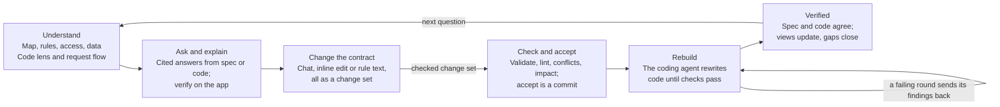
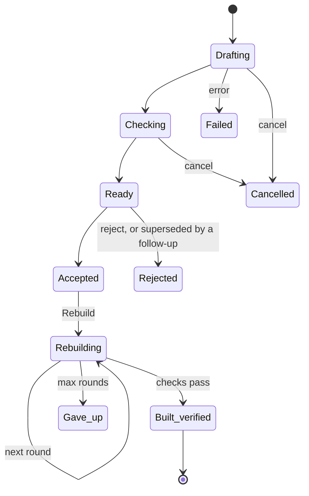
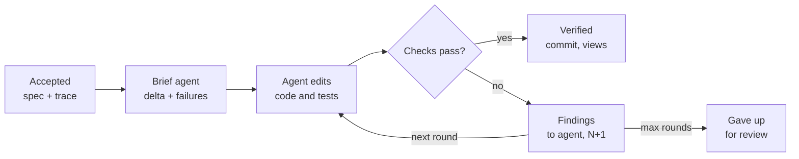

# Lattice Studio 2: design spec for the mock

Oct 9, 2026 · Vivek Gade

> Repo copy of the living doc: https://claude.ai/code/artifact/8989064c-cc58-470b-ab04-a005907d05d1
> (the doc is the source of truth; its three diagrams are redrawn here as Mermaid).
> Builds on `docs/design/lattice-visualization-figma-spec.md` (the owner's; unchanged).

## Purpose, users and principles

Studio 2 lets a spec owner see what their app is supposed to do and what the code actually does, side by side, then change the contract and have the coding LLM rebuild the code until Lattice proves it. It keeps everything Studio 1 does (views, cited questions, checked change sets) and adds the code itself and the rebuild loop.

**Who it serves**

| Person | What they come to do | Where they spend time |
| --- | --- | --- |
| Spec owner (product engineer, tech lead) | Understand the rules, ask questions, change the contract, approve | Map, Rules, Access, the conversation |
| Developer driving a coding agent | See why a rule fails, read the code behind it, let the agent rebuild | Code lens, Request flow, the rebuild timeline |
| Reviewer | Decide whether a change is safe to ship | The change tray, Evidence, the rebuild result |

**Principles**

1. **Intent and code, joined.** Every rule links to the code that enforces it, and every line of code that writes data links to the rules it serves. A rule with no enforcing code is a visible gap.
2. **Plain language first, source one click away.** Rules show as sentences; the spec and the code are a toggle or a panel, never the default.
3. **Nothing changes without a checked change set.** Chat edits, direct edits on a view and edits to the requirements text all land as a pending change set that is validated, linted, conflict-checked and run against the app before anyone accepts it.
4. **Trust states are first class.** Checked, not checked, untraced, probe gap and not built yet each have one colour, icon and label, everywhere. An unchecked rule never looks checked.
5. **Evidence, not opinion.** Every red mark links to the rule it breaks and a reproducible counterexample. Every chat answer cites what it rests on, or says the spec does not say.
6. **The contract drives the code.** Accepting a change does not edit code by hand. It reinforces the spec, and the coding agent rebuilds until the checker passes; the UI shows each round.

## The core loop

Studio 2 is built around one loop: understand, ask, change, check and accept, rebuild, verified. Every screen exists to move the user one step around it.

Read clockwise from the top left. Asking never changes anything; changing never touches code; only the rebuild touches code, and it stops only when the checker passes.

| Step | Where it happens | What the user sees |
| --- | --- | --- |
| Understand | Map, the intent views, Code lens, Request flow | Rules as sentences, each linked to its checks and its code |
| Ask and explain | Conversation, Ask or Explain mode | A yes / no / value / not-specified answer with checked citations, optionally verified on the running app |
| Change the contract | Conversation in Change mode, inline editors, the Rules text | A pending change set in the tray, drawn as amber diffs on the views |
| Check and accept | Change card, tray | Valid, lint, conflicts with their questions, impact by label; Accept writes the requirements, spec and trace in one commit |
| Rebuild | Rebuild card, tray, Code lens | Round-by-round progress: what the agent changed, the checker's findings, the next round |
| Verified | Every view | Amber marks turn plain, failing checks clear, the code lens shows the rebuilt lines |

## Layout and navigation

One screen, three panes and a tray: navigate on the left, look and edit in the middle, talk on the right, and track pending work at the bottom. Desktop frame: 1440 × 900.

| Region | Width | Holds |
| --- | --- | --- |
| Top bar | full, 56 px | Project name, git head, app status pill (last check: pass / fail · N findings / not run), **Run check**, **Rebuild** (enabled when an accepted change is not yet built), theme toggle, search (⌘K) |
| Navigator (left) | 240 px | Three groups: **Intent** (Map, Rules, Access, Data, Lifecycle, Invariants, Scenarios, Services), **Code** (Code lens, Request flow), **Evidence** (Gaps, Checks, Rebuilds). Each item shows a count and a trust-state dot when something needs attention |
| Canvas (centre) | fluid, min 640 px | The selected view. A **lens switch** at the top of every view: Intent / Code / Both. Both splits the canvas: the view on the left, the code for the selected element on the right |
| Conversation (right) | 400 px, collapsible | Ask, Change and Explain modes, context chips, answer and change cards (section 5) |
| Change tray (bottom) | 48 px collapsed, 280 px open | Every change set and rebuild in flight or waiting: status, request, checks summary, actions. Collapsed, it shows counts: "2 changes ready · 1 rebuilding" |

**Selection is global.** Clicking any element (a rule, a matrix cell, a state, a scenario step, a code line) selects it everywhere: it is highlighted in every view and pane that shows it, it becomes a context chip in the conversation, and the Code lens jumps to its code.

**Keyboard.** ⌘K search across rules, elements and code symbols · `J`/`K` move through a list · `Enter` open · `A` ask about the selection · `C` change the selection · `E` edit inline · `⌘↵` send · `Esc` close or clear the selection.

**Narrow screens.** Below 1180 px the conversation becomes a drawer; below 900 px the navigator becomes a top menu and the canvas is single-column. Tables and diagrams scroll inside their own containers; the page never scrolls sideways.

## The views

Ten views, each a different way into the same model. Every element in every view is selectable, shows its trust state, opens its code with the lens switch, and offers Ask and Change on hover.

| View | What it shows | What you can edit directly | Empty, loading and error states |
| --- | --- | --- | --- |
| **Map** (home) | The whole app on one canvas: tables as nodes, endpoints grouped by resource, background services, and the run lifecycle. Each node is tinted by its worst trust state; badges count rules, gaps and failing checks | Nothing (navigation only); double-click opens the element's view | No spec: "Draft a spec from your requirements" with a file picker |
| **Rules** | The owner's requirements document, rendered, with a status chip per rule (checked / not checked / context / untraced / probe gap / not built yet) and the checks and code linked to it | Edit any rule's text inline; the edit becomes a pending change (incremental draft) | A rule with no link shows a red "untraced" chip and a **Trace it** action |
| **Access** | Matrices per resource: callers × endpoints, each cell the statuses the spec expects (2xx green, 4xx neutral, 5xx red, · not stated) | Click a cell: choose allow / refuse 403 / hide 404; the change shows amber until accepted | A cell no scenario states shows · with "Make this a rule" |
| **Data** | Entity cards: columns, types, keys, unique rules, allowed values, limits, private columns (lock icon), relations between tables | Change a limit, add or remove an allowed value, mark unique or private | — |
| **Lifecycle** | Each state machine as a diagram: states, allowed moves, initial and final states | Add or remove a move, mark a state final | — |
| **Invariants** | One-line "always true" rules ("at most one live run per config") with their last check result | Edit a bound (1 → 2), add from a template (unique, at most N, sum equals) | — |
| **Scenarios** | Step stories: caller, request, expected answer and data effect, with the last run's actual result on failing steps | Edit an expected status or value; accept or reject generated scenarios | Search and filters: failing, touched by a pending change, by rule |
| **Services** | Background jobs (worker, scheduler) with their promises and wait limits | Edit wait limits | — |
| **Code lens** (new) | The source files behind the spec. Each handler is annotated in the gutter with the rules it enforces (chips), static findings inline (e.g. GO807 partial write), and coverage: green bar = lines exercised by passing scenarios, red = a failing check's path, grey = untested | Read only. Changes to code come only through a rebuild | A rule with no enforcing code is listed at the top as "no code found" |
| **Request flow** (new) | One request traced end to end: route → middleware (auth) → handler → database writes → response, with each step annotated by the rules it applies and the data it touches | Nothing; select a step to ask or open its code | Pick an endpoint and caller, or start from a scenario step |
| **Evidence** | Gaps (untraced rules, probe gaps with their patch, unchecked rules, open questions, lint), Checks (the last run's findings with counterexamples), Rebuilds (history) | Answer an open question, which becomes a change | — |

**Code lens details.** Left: a file tree filtered to files that touch the spec (handlers, models, migrations). Centre: the file with line numbers. Gutter chips show `R45 cancel` and the like; hovering one shows the rule's sentence and its check status. Clicking a chip selects the rule everywhere. A **why** button on any line asks the conversation "What rule does this line serve, and what breaks if it changes?" The lens never edits code itself.

**Request flow details.** A left-to-right lane diagram with one column per stage. A failing check overlays its path in red and marks the step where the actual answer diverged ("expected 409, got 201 at the unique check"). The same diagram renders for a pending change, showing what will differ.

## The conversation panel

One panel, three modes, always grounded in the selection: **Ask** answers from the spec, **Explain** answers from the code, **Change** proposes an edit to the contract.

**Anatomy, top to bottom**

1. **Open work strip:** compact rows for changes that are drafting, checking, ready or rebuilding (request, status, a Cancel on in-flight ones). Clicking one opens its card in the thread and draws its diff on the canvas.
2. **Mode switch:** Ask · Explain · Change.
3. **Thread:** the questions and answers, change cards, rebuild cards, newest at the bottom.
4. **Context chips:** the current selection ("cell eve × POST /runs/{}/cancel", "R45", "runs.go:126"), each removable; **+** adds from the canvas.
5. **Composer:** a text box, a **Verify on the app** toggle (Ask mode), and suggested prompts for the selection ("Who can do this?", "What breaks if this changes?", "Make this a rule").

**Answer card (Ask and Explain)**

| Part | Content | Behaviour |
| --- | --- | --- |
| Kind badge | Yes · No · Value · Not specified | Not specified is a neutral outlined badge, never green or red |
| Answer | One sentence | — |
| Explanation | 1–3 sentences | — |
| Citations | Chips: rule, cell, scenario step, invariant, code line (Explain mode) | Clicking one highlights it on the canvas; hover shows the quoted text. Rejected citations are listed struck through with the reason |
| Verification | Agrees · Disagrees · Inconclusive (a setup step failed) · Observed (what the app does today, for not specified) · Error | Shows the claim step and the generated scenario as readable steps; Disagrees links to the counterexample |
| Actions | Ask a follow-up · Make this a rule (for not specified) · Change this | Make this a rule switches to Change mode with the request prefilled |

**Explain mode** answers questions about the code ("Why does cancel return 409 here?", "Where is the one-live-run rule enforced?"). Its citations are code lines plus the rules they serve, and the Code lens opens at the cited lines. It never edits code.

**Change card** (section 7 has the lifecycle):

- the request and its parent, if it is a follow-up;
- a status stepper (drafting → checking → ready) with timings;
- rules added, changed and removed;
- the requirements diff;
- checks (valid, lint, conflicts with their question, impact by label);
- new questions;
- **Accept**, **Reject**, **Cancel**.

Each conflict and question has an inline **Answer** control (use the default, or type an answer). Answering sends a follow-up change that replaces this one when it is ready.

## Direct editing on the canvas

Every direct edit is a draft until checked. Editing a cell, a limit or a move never touches the spec directly: it opens a change set in the tray, and the edit shows amber in place until the change is accepted or rejected.

**How an inline edit works**

1. Press `E` on a selected element, or click its pencil.
2. An inline editor opens in place: a status picker for a matrix cell, a number field for a limit, a toggle for a move, a text field for a rule sentence.
3. **Save as change** creates a change set. The request text is written for you ("eve may not cancel runs: 200 → 403"), and you can edit it before sending.
4. The tray shows it drafting → checking → ready. The view keeps showing the amber edit.
5. Several edits before sending go into one change set. The tray badge counts them, and **Send** checks them together.

**Diff overlay conventions** (the same in every view)

| Mark | Meaning |
| --- | --- |
| Amber fill + "old → new" | A value this change set modifies (cell, limit, bound) |
| Green left bar + "+" | An element this change set adds (rule, scenario, move, invariant) |
| Red strike + "−" | An element this change set removes or retires |
| Dashed amber outline | An element the change does not modify but whose checks it affects (impact) |
| Banner at the top of the canvas | "Showing change c3: …" with **Accept**, **Reject** and **Hide diff** |

**Which edits are direct and which go through chat.** Structured values (statuses, limits, allowed values, moves, bounds) are direct. Anything that needs words (a new rule, a reworded rule, a new endpoint) goes through Change mode or the Rules text editor. Both produce the same kind of change set.

## The change-set lifecycle

A change set moves from drafting to built and verified; every other ending (failed, cancelled, rejected, gave up) leaves the spec and code as they were.

The top row is the contract; the right column is the code. Nothing reaches the code until a person accepts.

| State | Entered when | Actions | Shown as |
| --- | --- | --- | --- |
| Drafting | A chat request, inline edit or rule-text edit is sent | Cancel | Spinner row in the tray; stepper in the card |
| Checking | The draft loaded; validate, lint, conflicts and impact are running | Cancel | Same, step 2 |
| Ready | All checks finished | Accept (only when valid), Reject, Answer a conflict or question | Amber diffs on the views; full change card |
| Accepted | The owner accepted: one commit of requirements, spec and trace | Rebuild, Rebuild later | Tray row "accepted · not built"; Rebuild lights up in the top bar |
| Rebuilding | Rebuild started | Stop (between rounds) | Rebuild card with the round timeline (section 8) |
| Built, verified | A round's check passed | Open the diff, open the commit | Green row; amber marks turn plain on the views |
| Failed | The draft could not load or the edit could not be applied | Retry, Edit the request | Red row with the error |
| Cancelled | Cancel while drafting or checking | — | Grey row in history |
| Rejected | Reject, or replaced by a follow-up ("superseded by c4") | — | Grey row in history |
| Gave up | The rebuild reached its round limit with findings left | Review findings, Edit the change, Rebuild again | Amber row with the remaining findings |

**Checks on a ready change**

| Check | Passes when | If not |
| --- | --- | --- |
| Valid | The drafted spec loads and every rule is traced | Accept is disabled; problems listed |
| Lint | No new lint findings against the base spec | Listed with their fix; Accept still allowed |
| Conflicts | No two scenarios expect different answers to the same request | Each conflict shows its question and an Answer control |
| Impact | The new spec run against the current app | Failures labelled: **not built yet** (expected; the rebuild fixes these), **regression** (an unchanged rule now fails: investigate), **contradiction** (two rules disagree: answer the question) |

## Reinforce and rebuild

Accepting a change reinforces the contract; **Rebuild** hands that contract to the coding agent, which edits the code and runs the Lattice checker every round until it passes or reaches its round limit.

The checker, not the agent, decides when a rebuild is done. A failing round's findings become the next round's brief.

**What the agent is given (the brief)**

- the accepted change: rules added, changed and removed, and the spec diff;
- the checks labelled *not built yet* by the impact run (these are what must turn green);
- the gate command (`./check.sh`), and the rule that it must fix the code, never the spec;
- the files the Code lens links to the changed rules, as a starting point.

**Rebuild card** (in the thread and the tray)

| Part | Content |
| --- | --- |
| Header | The change it builds ("c1 · only admins cancel"), model, round N of max, elapsed time, **Stop** |
| Round timeline | One row per round: what the agent changed (files and a one-line summary), the check verdict with counts per layer (A, C, D, X), and its findings as chips that open the counterexample |
| Live target list | The *not built yet* checks from the impact run, each ticking green as a round passes it |
| Result | Passed: the commit, files changed, the code diff (opens in the Code lens), and "amber marks cleared". Gave up: the remaining findings, with **Edit the change** and **Rebuild again** |

**What changes on the views.** While rebuilding, elements the change touches show a small spinner on their diff mark. When the rebuild passes, amber marks turn plain, the app status pill turns to "pass", the Code lens marks the rebuilt lines "rebuilt in c1", and the Map's red dots clear.

**Batching.** Several accepted changes can rebuild together (one brief, one gate); the card lists each change and its targets separately.

## Components and tokens

Studio 2 reuses the tokens and components of the existing Figma spec (`docs/design/lattice-visualization-figma-spec.md`, §3 and §6) and adds only what the code lens, the change tray and the rebuild loop need.

**New tokens** (light and dark, defined on the same token sheet)

| Token | Used for |
| --- | --- |
| `pending` (amber) + `pending-bg` | Values a change set modifies, the change banner, the inconclusive badge |
| `added` (green bar) / `removed` (red strike) | Diff marks |
| `impact` (dashed amber outline) | Elements whose checks a change affects |
| `code-covered` / `code-failing` / `code-untested` | Code lens gutter bars |
| `rebuild-running` / `rebuild-passed` / `rebuild-failed` | Rebuild cards, the timeline and the tray |
| `verify-observed` (accent, informational) | Observed verification |

**New components**

| Component | Variants | Notes |
| --- | --- | --- |
| Lens switch | Intent · Code · Both | At the top of every view |
| Rule chip | Checked, not checked, context, untraced, probe gap, not built yet | Icon + word + colour, never colour alone |
| Gutter chip | Rule id + short name, count when several | In the code lens |
| Change row | Drafting, checking, ready, accepted, rebuilding, built, failed, rejected, cancelled | In the tray and the open-work strip |
| Change card | Collapsed, expanded, superseded | In the thread |
| Answer card | Yes, no, value, not specified × agrees, disagrees, inconclusive, observed, error | In the thread |
| Rebuild card | Queued, round N running, round N failed (findings), passed, gave up | In the thread and the tray |
| Diff mark | Modified, added, removed, impact | The same on every view |
| Inline editor | Status picker, number field, toggle, text | Opened with `E` |
| Lane diagram | Request flow stages | Request flow view |

## Data contracts

The mock builds against the Studio API in `lattice/studio/API.md` (v1.2: model, ask, change sets, check) plus new endpoints for the code lens, explain, request flow and rebuild. Everything is JSON over HTTP, and the client polls; there are no websockets.

| Endpoint | Returns | Status |
| --- | --- | --- |
| `GET /api/model` | Rules, views, data model, app status, changes | exists (v1.2) |
| `POST /api/ask` | Answer card: kind, answer, citations, verified | exists (v1.2) |
| `POST/GET/DELETE /api/changes`, `…/accept`, `…/reject` | Change sets, follow-ups via `parent` | exists (v1.2) |
| `POST /api/check` | Starts a full check; results in the model | exists |
| `GET /api/code/files` | Files that touch the spec: path, language, size, rule ids linked | **new** |
| `GET /api/code/file?path=` | Source lines plus annotations: `[{line, rules:["R45"], finding?:{code,message}, coverage:"covered"\|"failing"\|"untested"}]` | **new** |
| `GET /api/code/links?target=` | For a rule or element: code locations `[{path, line_from, line_to, symbol, why}]`; for a code location: the rules it serves | **new** |
| `POST /api/explain` | Like ask, answering from the code: citations may be `code:<path>:<line>` | **new** |
| `GET /api/flow?endpoint=&caller=` | Request-flow stages: `[{stage, symbol, path, line, rules, reads, writes}]` plus the divergence point of a failing check | **new** |
| `POST /api/rebuild` | Starts a rebuild for accepted, not-yet-built changes: `{changes:[ids], model?, max_rounds?}` → `{id}` | **new** |
| `GET /api/rebuild/{id}` | Rebuild record: status, rounds `[{n, started, agent_summary, files_changed, check:{verdict, counts, findings}}]`, final commit | **new** |
| `DELETE /api/rebuild/{id}` | Stops a rebuild between rounds | **new** |

**Where the new data comes from.**

- **Code links:** the spec trace (rule → scenarios), the scenarios' endpoints, the routes table and a code index (CodeGraph or tree-sitter: handler symbols, call edges, database writes). The *why* text comes from the static checker's findings or a one-line LLM summary that is cached.
- **Coverage:** which handler paths the passing and failing scenarios exercised, recorded during a check.
- **Rebuild:** the server runs the coding agent (Claude Code CLI) with the accepted change's spec delta as its brief and `./check.sh` as the gate, and stores each round's check result.

## Key flows for the mock

Six storyboards cover every capability. Build them as clickable prototype paths, frame by frame, with the job scheduler's data.

**A. Understand a rule down to its code**

1. Map: the JobRun node shows a red dot (2 failing checks). Click it.
2. Rules, filtered to JobRun: "R44 At most one queued or running run per config" has a green chip. Select it.
3. Lens switch → Both: on the right, `runs.go` opens at `startRun`, lines 26–47 highlighted, gutter chip R44 on the count check and the insert.
4. Click **why** on line 43: Explain answers "This 409 enforces R44; removing it lets a second live run in", citing `runs.go:43` and the scenario `one_live_run_per_config` step 2.

**B. Ask a question and verify it on the app**

1. Access matrix: select the cell eve × POST /runs/{}/cancel (200).
2. Conversation, Ask: "Can an executor cancel a run?" with Verify on.
3. The answer card: **Yes**, citations (the cell, scenario step, R4), Verification **Agrees**, claim step 4.
4. Hovering the scenario citation highlights its steps on the Scenarios view.

**C. Change the contract by chat, then rebuild**

1. Change mode: "Only app admins and the super admin may cancel runs; an executor gets 403."
2. The tray shows c1 drafting → checking (151 s in the real run; the mock can shorten it).
3. Ready: the canvas banner says "Showing change c1"; the matrix cell is amber, 200/409 → 403; Rules shows R4 and R46 with their text diff.
4. The change card: valid, 0 lint findings, 0 conflicts, impact "2 checks not built yet", question Q13 (refusal vs already-finished: default 403 first).
5. Accept → commit a610959. The top bar's **Rebuild** lights up: "1 accepted change not built".
6. Rebuild: the timeline (section 8) runs round 1 (2 findings) and round 2 (pass); the cell turns from amber to plain 403; the Code lens shows the changed `cancelRun` lines with a "rebuilt" marker.

**D. Direct edit on a view**

1. Invariants: "at most one live run per config". Press `E` and change 1 → 2.
2. **Save as change**; the request is prefilled ("at most two live runs per config").
3. Ready: impact lists the scenarios that assumed one, labelled not built yet; the unique-index finding explains that the app's schema still enforces one.
4. Reject: the overlay clears and the tray moves c2 to history.

**E. Answer a conflict in place**

1. A change card shows conflict: "eve POST /runs/{}/cancel: 200 vs 403 — which holds?"
2. Click Answer → Use default (403).
3. The follow-up c4 drafts; when ready it replaces c3's card, and c3 moves to history as "superseded by c4".

**F. Edit the requirements text**

1. Rules: click the text of R46 (retry) and add "… at most 3 retries per run".
2. Save as change: incremental draft; the change card shows 1 changed rule, the new scenario and invariant, and a question about what the 4th retry answers.
3. Accept, then Rebuild.

## Fixtures, accessibility and open questions

The mock uses the job scheduler's real data, so every frame shows true numbers and names.

**Fixtures**

| Need | Source (in the repos) |
| --- | --- |
| Model and views (65 rules, 159 scenarios, 21 endpoints, 5 tables) | `lattice/studio/mock/model.json`, built from `job-scheduler/metrics/authoring/review-data.json` |
| Requirements text | `job-scheduler-studio/REQUIREMENTS.md` |
| Ask answers (yes, not specified, inconclusive, observed) | `lattice/studio/mock/ask-*.json` |
| Change sets (cancel change, follow-up) | `lattice/studio/mock/change-c1.json`, `change-followup.json`; the real run in `job-scheduler-studio/evidence/e2e-change-c1.json` |
| Code for the lens and flow | `job-scheduler-go/internal/app/{runs,handlers,jobs,worker,scheduler}.go` (branch `multidb`) |
| Rebuild rounds | To write: the Go spec-first build's ticket-4 metrics (`job-scheduler-go/metrics/t4/`) have real round-by-round check results to base it on |
| Screens of the current Studio | `job-scheduler-studio/evidence/*.png` |

**Accessibility**

- Trust states and diff marks always pair colour with an icon and a word.
- Every matrix cell, chip and gutter mark has an accessible name ("eve, POST cancel, 403, pending change").
- Keyboard reaches every action. Focus is a visible 2 px ring. Diagrams have a table alternative.
- `prefers-reduced-motion` turns off pulses and spinners. Contrast is at least 4.5:1 for text in both themes.

**Out of scope for the mock:** editing code by hand, multi-user presence and comments, authentication, real-time collaboration.

**Open questions**

1. **Rebuild authority:** does Rebuild commit straight to the branch, or open a pull request for review?
2. **Code lens scope:** only files linked to the spec, or the whole repo with spec-linked files first?
3. **Batching:** should several accepted changes rebuild together by default, or one at a time?
4. **Surface:** a standalone web app first, or the IDE panel too?
5. **Explain mode cost:** cache explanations per symbol and git head, or always answer fresh?
